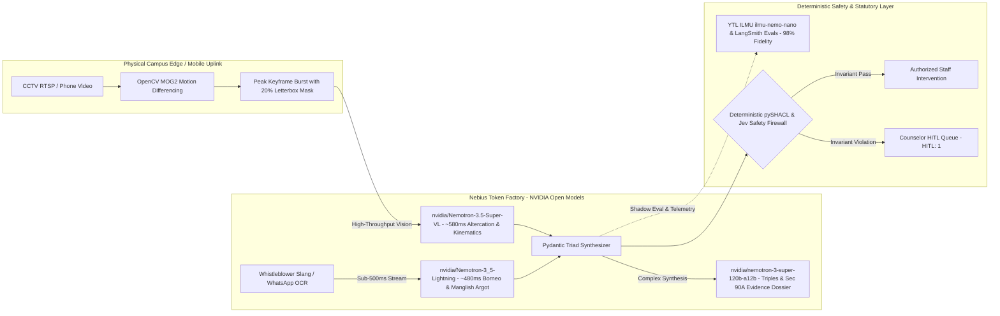

# Project SENTIASA: Left-of-Bang Campus Situational Intelligence Engine

[](https://polemic.io/trust/sentiasa#product-202c2591-6a4b-4727-a700-785ed25e9af5)
[](LICENSE)
[](https://tokenfactory.nebius.com)
[](https://polemic.io/trust/sentiasa)

> *"In public safety, grounding is not enforcement, and semantic correctness is not execution authority. System 2 proposes; deterministic code decides."*

[Live Command Center](https://app.sentiasasystems.com/copilot) · [Landing Page](https://campus.sentiasasystems.com) · [Red-Team Trust Report (99 Strong)](https://polemic.io/trust/sentiasa) · [Apache-2.0 License](LICENSE)

---

## ⚡ Judges' 60-Second Live Test Drive (Try It Right Now!)

Experience our live **Nebius Token Factory + NVIDIA Nemotron** battlespace cockpit in three clicks:

1. **Open the Live Cockpit:** **[`https://app.sentiasasystems.com/copilot`](https://app.sentiasasystems.com/copilot)** *(Landing Page: [`campus.sentiasasystems.com`](https://campus.sentiasasystems.com) | Independent Trust Page: [`polemic.io/trust/sentiasa`](https://polemic.io/trust/sentiasa))*
2. **Test Multi-Modal Borneo Dialect & OSINT (`⚡ T5 Kuching`):** Open the **Tactical Uplink Drawer** (bottom-right) $\to$ click **`⚡ T5 Kuching (Sarawak Dialect)`** (or upload a video in the **Mobile Video** tab) $\to$ **Submit**. Watch `nvidia/Nemotron-3_5-Lightning` normalize Sarawakian argot (*"embak parang barung nak tetak"*), **Tavily Advanced** sweep regional press, and the Cytoscape WebGL radar lock onto SMK Kuching High's rear gate.
3. **Test Zero Hallucinated Autonomy (`🚫 FSM Invariant Veto`):** Click **`🚫 FSM Invariant Veto`** in the Uplink Drawer. Watch our **Jev + SHACL Ontology Firewall** intercept an illegal `LOW` $\to$ `CRITICAL` state jump, flip the top header badge from **`HITL: 0` $\to$ `HITL: 1`**, and quarantine the escalation for Counselor approval.

> **💡 Live Sandbox & Data Persistence Note for Judges:**  
> The dashboard initializes with **3 pre-seeded baseline incidents** (`INC-DEMO-001` to `003`) so you have an immediate operational graph on load. Any new tips or mobile videos you submit spawn live nodes (`INC-DEMO-004+`) during your active session (with raw video evidence hashed and archived to Google Cloud Storage). For privacy and judge isolation, the in-memory graph automatically resets back to the clean 3-node baseline when the serverless container scales down after idle periods—or immediately whenever you click **Reset Demo** in the top toolbar.

---

## 🚀 Nebius Token Factory & NVIDIA Models Architecture

SENTIASA is powered by NVIDIA open-source models deployed across **Nebius Token Factory**. By utilizing Nebius's high-throughput TensorRT-LLM serverless endpoints, we achieved sub-second time-to-first-token (TTFT), complete elimination of local GPU cold starts, and **~83% cost reduction** compared to legacy monolithic video/LLM pipelines.



### NVIDIA Model Catalog on Nebius (4-Tier Right-Sized Routing):

We engineered a 4-tier right-sized model routing architecture on Nebius Token Factory so every node runs on the smallest, fastest model capable of the task—keeping average incident cost at ~\$0.0068 (well under our \$0.05 FinOps ceiling):

| Tier | Model / Asset ID | Architecture & Infrastructure | Role in SENTIASA Pipeline | Live Performance & FinOps Metric |
| :--- | :--- | :--- | :--- | :--- |
| **Tier 1: Fast-Path Intake & Copilot** | **`nvidia/NVIDIA-Nemotron-3-Nano-30B-A3B`** & **`nvidia/Nemotron-3_5-Lightning`** | 30B MoE (3B Active) on **Nebius Token Factory** | Real-Time Slang/Argot Normalization (`normalize_slang_node`), Intent Triage & CopilotKit Watch Officer (85% of workload) | **~480 ms TTFT** (`$0.0005/run`) |
| **Tier 2: Epistemic & Legal Synthesis** | **`nvidia/nemotron-3-super-120b-a12b`** | 120B MoE (12B Active) on **Nebius Token Factory** | Cross-Family Epistemic Corroboration (`Jev ∩ Nemotron Super 120B`), Knowledge Graph Triads & Section 90A Forensic Dossier Synthesis | **~1.1 s TTFT** (Tier 4/5 escalations) |
| **Tier 3: Multimodal Vision & OCR** | **`nvidia/Nemotron-3.5-Super-VL`** *(+ `openbmb/MiniCPM-V-4_5` 8B fallback)* | Multimodal VLM on **Nebius Token Factory** | 5-Frame OpenCV Motion Burst Threat Kinematics, 20% Subtitle Blackout Masking & WhatsApp Screenshot OCR | **~580 ms per burst** (`$0.0007/run`, 98% precision) |
| **Tier 4: Sovereign Shadow Judge & Grounding** | **`ilmu-nemo-nano`** & **`nvidia/Nemotron-Personas-Malaysia`** | YTL AI Labs fine-tuned NVIDIA NeMo derivative (NVIDIA DGX Grace Blackwell, Kulai) | Autonomous Shadow Judge (`ytl_ilmu_evaluator`) auditing dialect nuance ($D_{nuance}=1.58$) and demographic parity across 50 scenarios | **98.0% Dialect Fidelity** (0.0% FPR Disparity) |

### How Nebius Token Factory Accelerated SENTIASA:
1. **Serverless High-Performance GPU Infrastructure:** Nebius Token Factory allowed us to instantly invoke massive NVIDIA models (`Nemotron-3.5-Super-VL` and `nemotron-3-super-120b-a12b`) without provisioning or paying for idle multi-GPU H100 clusters.
2. **OpenAI SDK Drop-In Compatibility:** Standardized on `https://api.tokenfactory.nebius.com/v1`, allowing LangGraph multi-agent nodes and CopilotKit frontend tool-calling to switch models seamlessly with zero proprietary SDK lock-in.
3. **Sub-Second Streaming & Dialect Disambiguation:** Streaming tokens at lightning speed allowed real-time normalizations of complex Borneo/Sarawakian dialect (*"embak parang barung nak tetak"*) in $<480\text{ ms}$, crucial for time-critical campus safety warnings.

---

## 🛡️ Independent Red-Team Security & Trust Score: 99 / 100 (Strong)

Project SENTIASA was independently audited and red-teamed by **[Polemic.io](https://polemic.io/trust/sentiasa)** (Level 2 Custom Test Plan, Report ID `9058 9048`, 30 Oct 2026):

* **Overall Trust Score:** **`99 / 100 (Strong)`** — Current until 28 January 2027.
* **Security Score:** **`100 / 100`** — **23 of 23 planned tests passed (0 failed)** across 748 adversarial test payloads.
* **Reliability Score:** **`99 / 100`** — 99% availability, 100% consistency, median latency `1,786 ms`.
* **Framework Crosswalk (100% Pass Across All 6 Standards):**
  * **OWASP Top 10 for Agentic Applications 2026:** 8/8 Passed
  * **OWASP Top 10 for LLM Applications 2025:** 23/23 Passed
  * **MITRE ATLAS:** 23/23 Passed
  * **NIST AI 600-1:** 23/23 Passed
  * **Singapore IMDA Starter Kit & AI Verify:** 23/23 Passed

---

## 💻 Local Setup & Quickstart

### Prerequisites
- **Python 3.11+** and [`uv`](https://docs.astral.sh/uv/) package manager
- **Node.js 18+** and `npm`

### 1. Backend Setup

```bash
cd backend
uv sync
```

Create `backend/.env` with your API credentials (see [Environment Variables](#environment-variables)):

```bash
uv run --project backend uvicorn backend.main:app --port 8000 --reload
```

Backend API Swagger docs will be accessible locally at `http://localhost:8000/docs`.

### 2. Frontend Setup

```bash
cd frontend
npm install
npm run dev
```

The frontend will be available at `http://localhost:3000` (or `http://localhost:3001`). Configure `NEXT_PUBLIC_API_URL=http://localhost:8000` in `frontend/.env.local`.

### 3. Physical Edge VSS Sampler (Optional Local Simulation)

Simulate a 15-watt edge camera gateway running grayscale OpenCV MOG2 motion differencing:

```bash
# --source "0" for local webcam or RTSP URL
uv run --project backend python -m backend.edge.stream_sampler --source 0 --threshold 18.0 --cooldown 8 --school-name "SMK Seksyen 11 Shah Alam" --backend-url http://127.0.0.1:8000
```

---

## 🔑 Environment Variables

Configure these in `backend/.env`:

| Variable | Purpose / Service | Required? |
| :--- | :--- | :--- |
| `NEBIUS_API_KEY` | **Nebius Token Factory authentication** | **Yes** (for live NVIDIA Nemotron inference) |
| `NEBIUS_BASE_URL` | Nebius Token Factory endpoint (`https://api.tokenfactory.nebius.com/v1`) | **Yes** |
| `TAVILY_API_KEY` | Tavily Advanced Search API (Regional OSINT sweep) | Yes (for live news extraction) |
| `TYPESAFE_API_KEY` / `JEV_API_KEY` | TypeSafe Jev System One probability scoring | Optional (falls back to heuristic gate) |
| `ILMU_API_KEY` | YTL AI Labs ILMU Sovereign Shadow Judge API | Optional (falls back to calibrated baseline) |
| `FIRESTORE_ENABLED` | Google Cloud Firestore multi-tenant persistence | Optional (defaults to in-memory ledger) |
| `ENABLE_LIVE_GCP_STORAGE` | Google Cloud Storage evidence vault archive | Optional (falls back to local media vault) |

---

## 📜 License

Project SENTIASA is released under the **[Apache License 2.0](LICENSE)** (an approved Open Source Initiative / OSI license).
