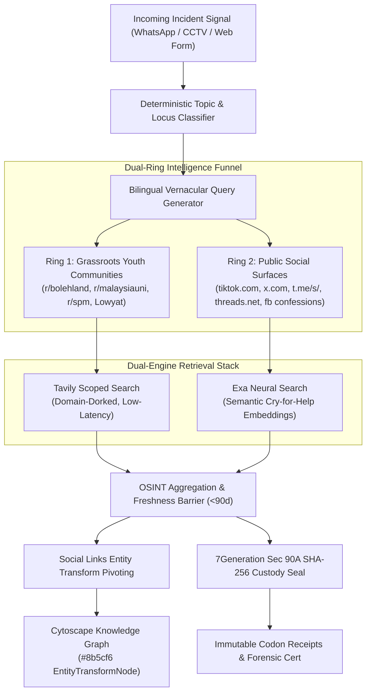

# Project SENTIASA: Left-of-Bang OSINT Situational Intelligence Architecture (v2)
### Sovereign Early-Warning Threat Detection, Social Links Entity Pivoting & 7Generation Statutory Custody

> **Classification:** Technical Architecture Specification  
> **Target Audience:** System Architects, Defense & Intelligence Evaluators, Cybersecurity Malaysia, Ministry of Education (MOE)  
> **Status:** Implemented & Verified in Production State Graph (v2.4.0)

---

## 1. Executive Summary & The Left-of-Bang Doctrine

Traditional threat monitoring and news gathering systems operate **"Right-of-Bang"**—reacting only *after* kinetic harm, hospital admission, viral video exposure, or formal police reports (PDRM). Mainstream news outlets (*The Star*, *Harian Metro*, *Berita Harian*, *New Straits Times*) publish incidents 24 to 72 hours post-event. In campus safety and student suicide prevention, Right-of-Bang reporting is an institutional failure.

```
                              THE TIME HORIZON
  LEFT-OF-BANG (Early Warning Horizon)             RIGHT-OF-BANG (Post-Event Press)
 [T-14 Days to T-6 Hours]                         [T+24 Hours to T+72 Hours]
┌───────────────────────────────────────────────┐ ┌────────────────────────────────┐
│ • Reddit (r/bolehland, r/malaysiauni, r/spm) │ │ • Harian Metro / The Star      │
│ • Lowyat Kopitiam / Campus Threads            │ │ • PDRM Press Conferences       │
│ • TikTok / Telegram Public Channel Dispatches │ │ • MOE Statutory Inquiry        │
│ • First-Person Peer Confessions               │ │ • Formal Criminal Charges      │
└───────────────────────────────────────────────┘ └────────────────────────────────┘
       ▲                                                 ▲
       │                                                 │
  SENTIASA OSINT v2 Focus                     Traditional News Scrapers
```

**Project SENTIASA** shifts the intelligence collection boundary **"Left-of-Bang"** (T-14 days to T-6 hours). By monitoring unindexed grassroots student discussion spaces, early warning signals such as senior ragging dares, hostel extortion rings (*"pau duit"*), dorm gang mobilization (*"turun padang"*), and anonymous cries for help (*"rasa nak mati / penat hidup"*) are detected before violence manifests on campus grounds.

---

## 2. Dual-Ring Social Surface Routing Architecture

To reconcile the closed nature of modern mobile social apps with open web retrieval standards, SENTIASA organizes domain discovery into two concentric collection rings:



### 2.1 Ring 1: Grassroots Youth Communities (Primary Early Warning)
* **Target Domains:** `reddit.com/r/bolehland`, `reddit.com/r/malaysiauni`, `reddit.com/r/spm`, `forum.lowyat.net`.
* **Nature:** Anonymous, long-form discussion forums where Malaysian students seek peer advice, blow the whistle on hostel wardens, or discuss ongoing bullying incidents without institutional censorship.
* **First-Person Vernacular Dorks:** Rather than querying third-person journalistic phrases, queries target first-person spoken Malay:
  * Extortion: `("kitorang kena pau" OR "senior pau" OR "mintak duit" OR "tiap hari ugut")`
  * Hostel Ragging: `(asrama OR dorm OR "budak hostel") ("nak belasah" OR "kena tapau" OR "batch junior")`
  * Distress: `(spm OR uni OR hostel) ("tak tahan" OR "penat hidup" OR "rasa nak mati")`

### 2.2 Ring 2: Public Social Surfaces & Regional Press (Corroboration)
* **Target Domains:** `tiktok.com`, `x.com` / `twitter.com`, `t.me` (Telegram web channels), `threads.net`, `facebook.com` (school confession pages), and targeted regional newspapers (*Utusan*, *Sinar Harian*, *Harian Metro*, *The Star*).
* **Nature:** Real-time viral dispatches, student video leaks, and official post-incident reports used to cross-corroborate physical altercations.

---

## 3. Dual-Engine Retrieval Stack (Tavily + Exa)

SENTIASA leverages two specialized search engines executing concurrently in a thread pool with strict timeout controls:

| Capability | Tavily Engine | Exa Neural Engine |
| :--- | :--- | :--- |
| **Search Paradigm** | Exact-match, keyword-scoped dorking | Neural vector embeddings (semantic search) |
| **Primary Strength** | Domain filtering (`include_domains`) and news synthesis | Finding peer confessions without explicit keywords |
| **Extracted Artifacts** | Clean snippets, raw titles, published dates | Verbatim quote highlights with character spans |
| **Execution Depth** | Basic (Tier 1-2) vs Advanced (Tier 3-5) | Semantic similarity threshold ($\ge 0.70$) |
| **Latency Budget** | $1200\text{ ms} \pm 300\text{ ms}$ | $1400\text{ ms} \pm 400\text{ ms}$ |

### 3.1 Concurrency & Wall-Clock Minimization
Both engines are dispatched via `concurrent.futures.ThreadPoolExecutor(max_workers=3)` bounded by a **3.5-second hard timeout**. Even if an upstream provider experiences network degradation, the state engine captures partial results and continues downstream graph processing without blocking the operator.

---

## 4. Social Links-Style Entity Transform Pivoting

Inspired by the entity transformation methodologies pioneered by **Social Links** and **7Generation**, SENTIASA implements automated graph pivoting to link virtual social discourse to physical campus infrastructure:

```
[Virtual Social Item] ──(Entity Transform)──► [EntityTransformNode] ──(TRANSFORM_CORROBORATES)──► [Physical Locus Node]
 (e.g. Reddit Thread)                          (e.g. "Blok C Asrama")                              (e.g. SMK Seksyen 11)
```

### 4.1 Bounded Regex & Semantic Locus Extraction
The parser scans raw queries and retrieved thread bodies for high-signal Malaysian educational and residential patterns:
* **School Acronyms:** `SMK`, `MRSM`, `KV` / `Kolej Vokasional`, `SBP`, `SMJK`, `SRK`, `SK`, `UPNM`, `UiTM`.
* **Hostel Architecture:** `Blok/Asrama [A-Z0-9]+`, `Dorm [0-9]+`, `Dewan Makan`, `Bilik Rehat`.
* **Social User Handles:** `@([A-Za-z0-9_]{3,24})`.

### 4.2 Cytoscape Visual Mapping
Extracted entities are synthesized into `EntityTransformNode` elements:
* **Node Type:** `EntityTransformNode`
* **Visual Signature:** Violet hex color (`#8b5cf6`), distinct rounded rectangular polygon shape, and pulsing border.
* **Edge Type:** `TRANSFORM_CORROBORATES` with label `"corroborates_institutional_locus"`.
* **State Grounding:** Pivoted node IDs are registered in `cytoscape_active_node_ids`, ensuring that operators clicking an incident in the triage feed immediately see the connected virtual and physical loci on the canvas.

---

## 5. 7Generation Lawful Custody Protocol (Section 90A Evidence Act 1950)

In high-stakes disciplinary hearings and criminal court proceedings, open-source intelligence is frequently challenged on chain-of-custody grounds. To satisfy **Section 90A of the Malaysian Evidence Act 1950 [Act 56]** (*Admissibility of documents produced by computers*), SENTIASA creates tamper-evident cryptographic seals for every retrieved OSINT artifact.

### 5.1 Evidence Act 1950 SHA-256 Digest Formula
For every piece of evidence, a canonical string payload is constructed and hashed:
$$\text{Digest} = \text{SHA-256}\left(\text{URL} \parallel \text{Title} \parallel \text{Snippet} \parallel \text{PublishedDate} \parallel \text{Timestamp}_{\text{ingest}}\right)$$

The complete OSINT collection is then bound into an overarching `osint_custody_hash`:
$$\text{CustodyHash} = \text{SHA-256}\left(\bigoplus_{i=1}^{n} \text{Digest}_i\right)$$

This hash is stamped onto the formal **Section 90A Statutory Forensic Certificate** and permanently recorded in the ledger.

### 5.2 Immutable Codon Receipts
Every search operation generates a structured computational receipt in `osint_codons`:
```json
{
  "codon_id": "codon_osint_tavily_1730000000",
  "operation": "DUAL_FUNNEL_OSINT_RETRIEVAL",
  "engine": "tavily+exa",
  "model_used": "tavily-advanced / exa-neural",
  "prompt_or_query": "Malaysia school (asrama OR dorm) (buli OR gaduh)",
  "verdict_or_output": "RETRIEVED_2_CORROBORATED_EXHIBITS",
  "latency_ms": 1342.5,
  "cost_usd": 0.015,
  "timestamp": "2026-10-23T02:00:00Z"
}
```

---

## 6. Dynamic Slang Glossary & Polysemy Disambiguation

Student communications rely heavily on regional dialects, colloquial slang, and polysemous loanwords. Project SENTIASA combines static curated lexicons with dynamic administrative persistence.

### 6.1 Multi-Dialect Coverage Matrix
* **Borneo Cohort (Sabah & Sarawak Vernacular):**
  * *Sabahan:* `antam` (violently beat up with brute force), `palui` / `paloi` (reckless victim/fool), `bubut` (hostel pursuit/chase down), `tampung` (gang assault/ambush), `buyuk` (deceptive extortion), `pilak` (provocation slur), `kondem` (cyberbullying/condemnation), `parang barung` (Sabahan bladed weapon).
  * *Sarawakian:* `tetak` (slash/hack with parang), `kelar tangan` (acute self-harm/wrist slitting), `sik tahan` (reaching psychological breaking point), `sidak` (hostile peer group/extortion gang), `pukul curi` (sucker punch/ambush).
* **Tagalog & Suluk Cohort (East Sabah Coastal / Cross-Border Youth Slang):**
  * Highly prevalent in East Sabah coastal hubs (Sandakan, Tawau, Semporna, Lahad Datu, Kota Kinabalu) where cross-border maritime loanwords are spoken in school compounds and peer confrontations:
  * `patay` / `patayin` (death threat / murder intent: *"patay ka nanti"*), `saksak` (stabbing with knife or blade), `suntok` / `suntukan` (fist assault / brawl challenge), `bugbog` (severe gang battery/mauling), `baril` (firearm/gun threat), `nakaw` (physical extortion of belongings), `holdup` (armed campus mugging), `tarantado` (hostile provocateur), `gago` (verbal insult triggering fights), `putang` (aggressive vulgar intimidation).
* **Northern Spoken Malay (Kedah/Penang):** *paloi* (foolish), *tokak* (bite/attack), *ketegaq* (stubborn).
* **Eastern Dialects (Kelantanese/Terengganu):** *sakau* (extort/steal), *tubek* (come out to fight), *gocoh paroh* (violent clash).
* **Colloquial Youth & Hostel Slang:** *tapau* (beat up), *pau* (extort), *koyak* (mental breakdown), *tibai* (physically batter), *belasah* (assault).
* **Cross-Cultural Vernaculars:** Chinese school slang (SJKC: *砍人*, *巴冷刀*, *围殴*, *收保护费*), Tamil vernacular (SJKT: *கத்தி*, *தாக்குதல்*, *மிரட்டல்*), and Jawi script orthography (*ڤارڠ*, *بلاساه*, *اوݢوت*, *بونوه ديري*).

### 6.2 Dynamic Persistence Architecture
* **Primary Store:** Firestore document path `settings/slang_glossary` in Google Cloud.
* **Resilient Fallback:** `InMemoryLedger` retains an active in-memory dictionary during local offline runs.
* **REST Endpoints:**
  * `GET /api/slang/glossary`: Returns the complete glossary with dialect categories and severity boosts.
  * `POST /api/slang/glossary`: Permits authorized `SUPER_ADMIN` operators to add new slang words dynamically without server re-deployment.

### 6.3 Contextual Polysemy Disambiguation (TypeSafe Jev)
Words like *"tapau"* and *"pau"* have harmless literal meanings (food takeaway, steamed buns) alongside violent/criminal connotations. When flagged, the pipeline passes the phrase to TypeSafe Jev System One to calculate contextual threat probability ($NOUL$). If offline, deterministic keyword proximity heuristics (presence of food markers vs hostel/violence markers) provide zero-latency disambiguation.

---

## 7. Sovereign FinOps, Rate-Limiting & Shielding

To guarantee zero billing surprises on Google Cloud Run and external APIs, SENTIASA implements a strict FinOps defense perimeter:

1. **Pre-Call Budget Reservation:** Before any API request is dispatched to Tavily or Exa, `BudgetLedgerManager.reserve()` verifies that the incident has not exceeded its allocated compute cap ($0.05 USD). If frozen or capped, search defaults to hermetic mock mode.
2. **Tier-Adaptive Depth:** Tier 1–2 (Low/Elevated) events run `basic` Tavily search ($0.005 USD); only Tier 3–5 (High/Critical/Lethal) events escalate to `advanced` search ($0.010 USD).
3. **Frontend Page Visibility Backoff:** The web UI stops background sync polling when the user switches tabs, preventing unneeded server wakeups.
4. **Bi-Temporal Freshness Gate:** Results older than 90 days are automatically filtered out to eliminate stale historical noise.

---

## 8. State Schema Contract

The following typed fields are guaranteed across the LangGraph state cycle:

```typescript
interface OSINTEvidenceItem {
  title: string;
  url: string;
  platform: "malaysian_press" | "reddit" | "lowyat_forum" | "tiktok" | "twitter_x" | "telegram" | "facebook_confessions" | "threads";
  engine: "tavily" | "exa" | "url_extractor" | "tavily_mock" | "exa_mock";
  snippet: string;
  highlights: string[];
  published_date: string;
  is_fresh: boolean;
  relevance_score: number;
  horizon_phase: "LEFT_OF_BANG_PRECURSOR" | "RIGHT_OF_BANG_CORROBORATION";
  sha256_custody: string;
}

interface FusedSensoryPayload {
  // ... Visual & Slang fields ...
  osint_corroborated: boolean;
  external_citations: string[];
  pivoted_nodes: Array<{ id: string; type: string; label: string; relation: string }>;
  osint_ai_synthesis?: string;
  osint_custody_hash?: string;
  osint_horizon_phase: "LEFT_OF_BANG_PRECURSOR" | "RIGHT_OF_BANG_CORROBORATION";
  osint_codons: CodonReceipt[];
}
```

---

## 9. Conclusion

By combining **Left-of-Bang early warning targeting**, **Dual-Ring domain routing**, **Social Links-style entity graph transformation**, and **7Generation Evidence Act Section 90A lawful custody**, Project SENTIASA provides school leadership and law enforcement with a legally unassailable, proactively grounded situational intelligence platform.
